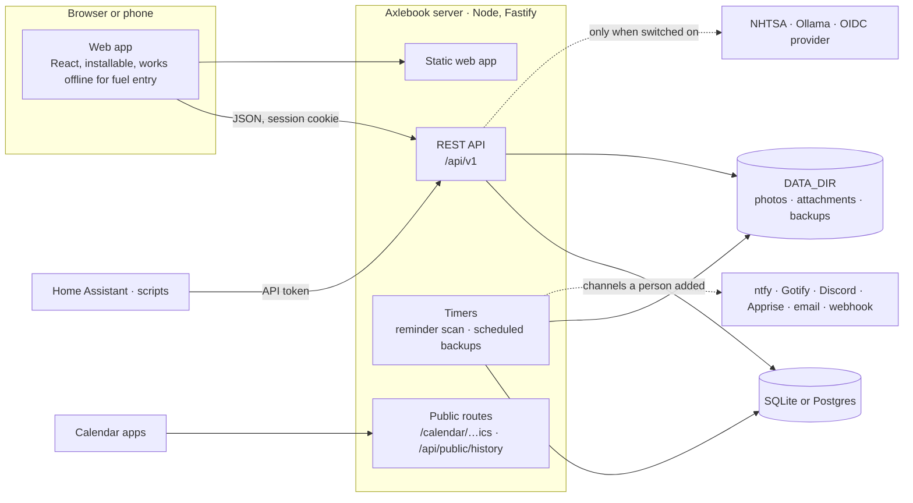

# Architecture

How Axlebook is put together, for anyone about to change it. [CONTRIBUTING.md](CONTRIBUTING.md)
covers setup and conventions; this is the map.

## The shape of it

One Node process serves everything: the REST API, the built web app, the calendar feed and shared
history links. It keeps its data in one SQLite file (or a Postgres database) and its files in a
folder. There is no queue, no cache server and no second service to run.



Nothing on the dotted lines happens unless someone configures it.

## Repository layout

```
packages/shared/   What both sides agree on: Zod schemas for every request and response,
                   domain rules (fuel economy, reminder status, due-date prediction, quiet
                   hours, money, units, dates), error codes, and the locale files.
                   Imported as TypeScript source; there is no build step.
apps/server/       The API. src/app.ts wires it; src/modules/<feature>/ holds each feature.
apps/web/          The web app. File-based routes in src/routes, API hooks in src/api.
integrations/      Things that talk to Axlebook from outside (Home Assistant).
e2e/               Browser tests against the real build.
tools/             Scripts that turn the brand kit into tokens, icons and public assets.
logo-assets/       The brand kit. Read-only.
docs/              Configuration reference, release checklist, screenshots.
```

## Server

`apps/server/src/app.ts` builds the Fastify app: plugins, then services, then one route plugin per
module, all under `/api/v1`.

| Module          | What it owns                                                                          |
| --------------- | ------------------------------------------------------------------------------------- |
| `auth`, `users` | Sessions, API tokens, first-run setup, OIDC, accounts and roles                       |
| `vehicles`      | Vehicles, photos, sharing (`access.ts` is the one place that decides who may do what) |
| `records`       | Service, repair, upgrade, fuel and expense records, tags, attachments                 |
| `odometer`      | The odometer log and fuel economy                                                     |
| `reminders`     | Reminders, their live status and predicted due dates                                  |
| `notifications` | Channels, the scan that sends them, quiet hours, digests, per-vehicle mute            |
| `documents`     | Registration, insurance, inspections and permits with expiry dates and scans          |
| `trips`         | The trip log and yearly mileage report for business vehicles                          |
| `history`       | The service history report, share links, and the public route that serves them        |
| `lookups`       | VIN decoding and recall checks through NHTSA, behind an admin switch                  |
| `reports`       | Spending reports and total cost of ownership                                          |
| `inventory`     | Parts and the planner                                                                 |
| `import-export` | CSV import and export, other apps' exports, backups (`backup.ts`) and restore         |
| `spreadsheet`   | Workbook import: header matching, preview, commit, saved mappings                     |
| `commercial`    | DVIR inspections and the IFTA worksheet                                               |
| `calendar`      | The iCalendar feed                                                                    |
| `insights`      | Maintenance schedules and tips                                                        |
| `assistant`     | The optional local assistant (Ollama)                                                 |
| `integrations`  | `GET /status`, a compact summary for Home Assistant and scripts                       |
| `settings`      | Instance settings                                                                     |
| `system`        | Health and public configuration                                                       |

### A request, start to finish

1. `rewriteUrl` strips the mount path if the server sits under one (`lib/urls.ts`).
2. `plugins/auth.ts` resolves the person from an API token or the session cookie. Everything
   under `/api/v1` needs one, apart from a short list of public routes.
3. `plugins/csrf.ts` refuses writes whose `Origin` isn't this server's, unless they carry a token.
4. The route's Zod schemas validate the input and shape the output. The same schemas generate
   `/api/openapi.json` and `/api/docs`.
5. The handler calls `requireVehicle(db, user, id, need)` for anything that belongs to a vehicle.
   A vehicle you can't see and one that doesn't exist both answer 404.
6. Errors are thrown as `AppError(code, params)` and leave as `{ error: { code, params } }`. The
   server never sends prose; the web app translates the code.

`modules/auth/permissions.test.ts` reads every route from the OpenAPI document and fails if one
isn't classified, so a new route can't ship without its access rule being tested.

### Data

Kysely over SQLite (better-sqlite3) or Postgres, chosen from `DATABASE_URL`. The schema is the
same on both, which shapes a few conventions:

- ids are integers; timestamps are ISO text written by the application; dates are `YYYY-MM-DD`
  text; booleans are 0 or 1.
- Money and fuel volume are integer milli-units (1000 = 1.000). No floats for money.
- Odometers are whole numbers in the vehicle's own unit; conversion happens when displaying.
- Free-form preferences are JSON text read through a parser that falls back to defaults
  (`parseViewPrefs`, `parseNotifyPrefs`, `parseSpecs`), so a bad value can't break a page.

Migrations live in `db/migrations/NNNN_*.ts`, are registered in `migrations/index.ts`, and run
when the server starts. A shipped migration is never edited. `upgrade.test.ts` loads a database
at the 1.0 schema, fills it, runs every later migration and checks the data and the API still
work.

| Migration | Adds                                                                              |
| --------- | --------------------------------------------------------------------------------- |
| 0001–0005 | The 1.0 schema                                                                    |
| 0006      | Saved spreadsheet column mappings                                                 |
| 0007      | Vehicle engine, parts sheet, use, current value; recalls                          |
| 0008      | Trips; vehicle documents                                                          |
| 0009      | Notification preferences, per-vehicle mute, held-message queue, date and currency |
| 0010      | History share links                                                               |

Files (vehicle photos, record attachments, document scans) are stored under random keys in
`DATA_DIR` by `lib/files.ts`, typed by their bytes rather than the name or type the browser sent,
and served with a sandboxing Content-Security-Policy.

### Background work

Two timers, both started in `server.ts`:

- `NotificationService.scan()` every `REMINDER_SCAN_INTERVAL_MIN`: sends what quiet hours held
  back, announces reminders and documents that got worse (each step once), rechecks recalls
  weekly when lookups are allowed, and sends weekly digests that are due.
- `BackupService.tick()` every 15 minutes: writes a scheduled backup when one is due and prunes
  old ones.

Both are plain methods that take the current time as an argument, which is how the tests drive
them.

### Calls that leave the server

Each has one client, injected into `buildApp` so tests replace it and nothing real is contacted:

- `lib/nhtsa.ts` (VIN and recalls): only when an admin has switched online lookups on.
- `lib/ai.ts` (Ollama): only when `OLLAMA_URL` is set.
- `NotificationService.send()`: only to channels a person added.
- `modules/auth/oidc.ts`: only when `OIDC_*` is set.

## Web app

React with TanStack Router (file routes, each its own lazily loaded chunk) and TanStack Query for
server state. There is no client-side store beyond the query cache; preferences live on the
account.

- `src/api/*` wraps every endpoint in a query or mutation. `client.ts` is the single `fetch`.
- `src/lib/format.ts` formats money, dates, distances and economy for the signed-in person's
  currency, date order, units and language.
- `src/lib/base.ts` knows where the app is mounted. The build uses relative URLs and the server
  writes a `<base>` tag into the page, so one image serves `/` or `/axlebook/`.
- `src/lib/outbox.ts` is the offline queue for fuel entries (IndexedDB). Each entry carries a
  client id, so a retried sync never creates a duplicate.
- `src/i18n` loads English up front and other languages on demand. No text is hardcoded: Biome
  rejects literal JSX text, and a test fails on missing or unused keys.
- `src/theme/tokens.css` and `components/icons.gen.ts` are generated from the brand kit.

Two routes render without the app shell or a session: `/login` and `/setup`, and `/h/$token`, the
public view of a shared service history.

## Tests

| Layer                                             | Where                                  | Run with                      |
| ------------------------------------------------- | -------------------------------------- | ----------------------------- |
| Domain rules (100% coverage, enforced)            | `packages/shared/src/domain/*.test.ts` | `npm run coverage`            |
| API, against SQLite in memory or a real Postgres  | `apps/server/src/**/*.test.ts`         | `npm test`, `npm run test:pg` |
| Components and screens (jsdom, stubbed `fetch`)   | `apps/web/src/**/*.test.tsx`           | `npm test`                    |
| The real build in a browser, desktop and phone    | `e2e/`                                 | `npm run e2e`                 |
| Home Assistant integration, inside Home Assistant | `integrations/home-assistant/tests`    | `python -m pytest`            |

## Releasing

Pushing a `vX.Y.Z` tag runs `.github/workflows/release.yml`: lint, typecheck and tests, then a
multi-arch image to GitHub Container Registry tagged with the version, its minor, its major and
`latest`. The version shown in the app comes from the tag at build time, and from `package.json`
when running from source. Notes for each release are in [CHANGELOG.md](CHANGELOG.md).
