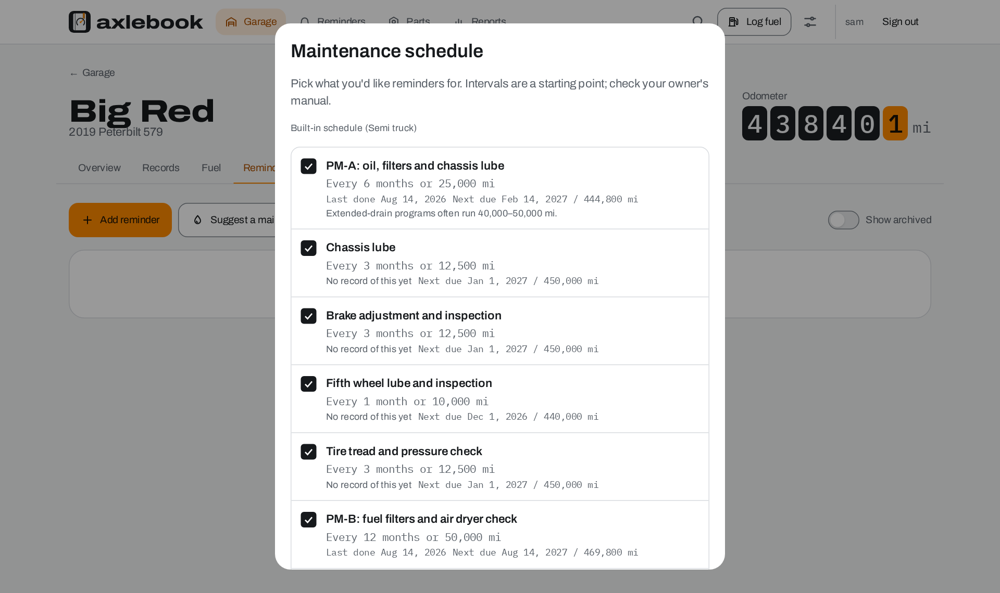
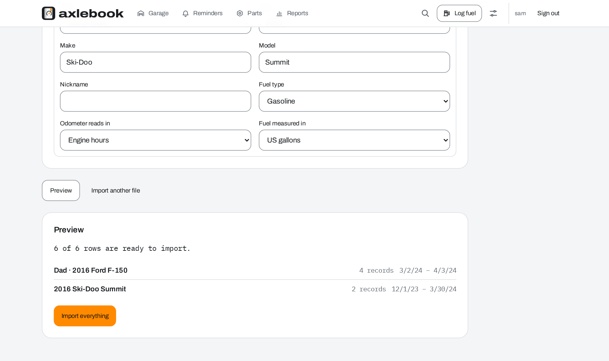
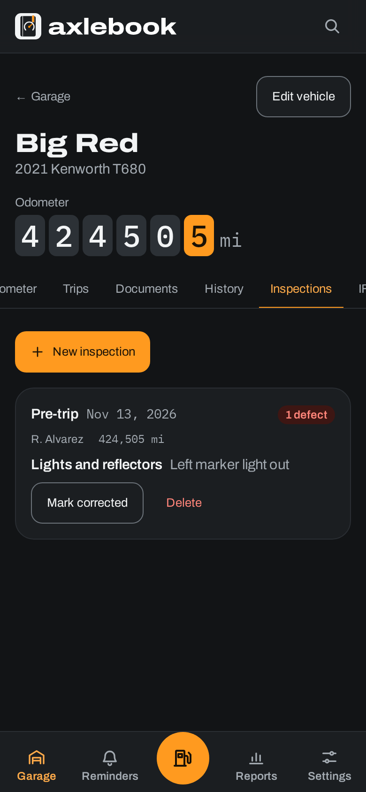

<picture>
  <source media="(prefers-color-scheme: dark)" srcset="logo-assets/social/readme-banner-dark-1600x400.png">
  
</picture>

<p align="center">
  <b>Every mile, on the record.</b><br>
  A self-hosted logbook for your cars, bikes, sleds and semis.
</p>

<p align="center">
  <a href="https://github.com/aubergine-ux/axlebook/actions/workflows/ci.yml"></a>
  <a href="LICENSE"></a>
  
  
</p>

<p align="center">
  <a href="#getting-started"><b>Getting started</b></a> ·
  <a href="#what-it-does">What it does</a> ·
  <a href="#screenshots">Screenshots</a> ·
  <a href="#configuration">Configuration</a> ·
  <a href="CONTRIBUTING.md">Contributing</a>
</p>

<br>

<picture>
  <source media="(prefers-color-scheme: dark)" srcset="docs/screenshots/garage-dark.png">
  
</picture>

## Why I made this

For years my truck's history lived in three places: a spreadsheet I stopped updating, a shoebox
of receipts, and a sticker in the corner of the windshield that was usually wrong. I wanted one
place that knew when the oil was actually due, what the truck really gets per gallon, and what it
has cost me since I bought it, without handing that to yet another app that wants an account and
a subscription.

Axlebook is that place. It runs on your own server or a Raspberry Pi in the closet, it doesn't
phone home, and your records never leave your network unless you send them somewhere.

## What it does

<table>
  <tr>
    <td width="33%" valign="top">
      <br>
      <b>Fuel economy you can trust</b><br>
      Log a fill-up in a few seconds at the pump, even with no signal. MPG (or L/100 km) is worked out full tank to full tank, so a partial fill or a fill-up you forgot to log doesn't wreck your average.
    </td>
    <td width="33%" valign="top">
      <br>
      <b>Reminders that know the odometer</b><br>
      Due by date, by distance, or whichever comes first. Log the oil change and the next one schedules itself. Get a nudge by email, ntfy, Gotify, Discord or a webhook when something is due soon or overdue.
    </td>
    <td width="33%" valign="top">
      <br>
      <b>Yours, on your hardware</b><br>
      One <code>docker compose up</code>. SQLite out of the box, Postgres if you'd rather. No telemetry, no outside calls unless you set up notifications, and a one-click backup of everything. The optional assistant runs on your box too.
    </td>
  </tr>
</table>

<table>
  <tr>
    <td width="50%" valign="top">
      <br>
      <b>Every job, with the receipt</b><br>
      Service, repairs, upgrades, fuel, and running costs like registration, insurance and tolls. Tag them, add notes, attach the photo or PDF.
    </td>
    <td width="50%" valign="top">
      <br>
      <b>An odometer log that keeps itself</b><br>
      Every record with a reading adds to it. Type a number lower than last time and it saves, but asks if you meant it.
    </td>
  </tr>
  <tr>
    <td width="50%" valign="top">
      <br>
      <b>Every kind of vehicle</b><br>
      Cars and pickups, motorcycles, dirt bikes, ATVs, snowmobiles, semis and trailers, each in its own garage section. Engine hours for the machines that don't count miles, mi/kWh for EVs, and nicknames so "Old Blue" is what you see. Lay the garage out your way: cards, compact or a list, sorted how you like or in your own order, showing the figures you care about.
    </td>
    <td width="50%" valign="top">
      <br>
      <b>A schedule that fits it</b><br>
      A maintenance schedule for each type of vehicle, checked against your own records: when you last did each job and when it's next due. Tick the ones you want and they become reminders.
    </td>
  </tr>
  <tr>
    <td width="50%" valign="top">
      <br>
      <b>Built for owner-operators too</b><br>
      Pre-trip and post-trip inspections (DVIR) with defects tracked until they're fixed, unit numbers, and an IFTA worksheet that splits each quarter's miles and fuel by state or province.
    </td>
    <td width="50%" valign="top">
      <br>
      <b>Tips from its own numbers</b><br>
      Economy slipping, too many partial fills, an overdue job that's costing you fuel, a sled that needs putting away for summer. Advice for that vehicle, not a generic list. Don't want them? Hide them with one tap.
    </td>
  </tr>
  <tr>
    <td width="50%" valign="top">
      <br>
      <b>A parts shelf</b><br>
      Oil, filters and spares, taken off the shelf automatically when a record uses them. A planner holds the jobs you mean to get to.
    </td>
    <td width="50%" valign="top">
      <br>
      <b>Reports worth printing</b><br>
      Spending by month and category, cost per mile, fuel economy over time and lifetime totals. Print them or download the CSV.
    </td>
  </tr>
  <tr>
    <td width="50%" valign="top">
      <br>
      <b>Bring your spreadsheet</b><br>
      .xlsx or .csv, one sheet per vehicle or all of them in one. Axlebook works out the columns, units and vehicles, shows a preview, and skips anything already in there. LubeLogger exports work too (experimental).
    </td>
    <td width="50%" valign="top">
      <br>
      <b>Find anything</b><br>
      Search every record in the garage by text, tag or type. Subscribe to a calendar link and due dates show up on your phone next to everything else.
    </td>
  </tr>
  <tr>
    <td width="50%" valign="top">
      <br>
      <b>For the whole household</b><br>
      Admin, editor and viewer accounts, per-vehicle sharing, and optional single sign-on through Authentik, Authelia, Keycloak or any OpenID Connect provider.
    </td>
    <td width="50%" valign="top">
      <br>
      <b>Your units, your way</b><br>
      Imperial or metric, any currency, light and dark, installable on your phone. Keyboard-accessible, and every word comes from a translation file. A REST API covers all of it.
    </td>
  </tr>
</table>

### Optional local assistant (Ollama)

If you run [Ollama](https://ollama.com) next to Axlebook, a model on your own machine can:

- **scan a receipt**: take a photo at the pump or the shop and the date, station, amounts and fuel
  go into the form, with the photo kept on the record;
- **fill in a record from a sentence**: "filled up 10.8 gal at 3.49, 61402 mi, civic";
- **answer questions from your logbook**: "when did I last change the oil on the Tacoma?", with
  links to the records it used, and a plain "that isn't in your records" when it isn't;
- help read a messy spreadsheet, tailor the maintenance schedule to your exact make and model,
  and give tips for each vehicle.

> [!NOTE]
> It's off unless you turn it on, and everything else works the same without it. Requests go only
> to your Ollama server, never to a cloud service. Whatever it reads is a suggestion: nothing is
> saved until you check the form and press Save.

## Screenshots

<table>
  <tr>
    <td colspan="4">
      <picture>
        <source media="(prefers-color-scheme: dark)" srcset="docs/screenshots/vehicle-dark.png">
        
      </picture>
    </td>
  </tr>
  <tr>
    <td colspan="2" width="50%" valign="top">
      <picture>
        <source media="(prefers-color-scheme: dark)" srcset="docs/screenshots/schedule-dark.png">
        
      </picture>
      <p align="center"><sub>A schedule that knows what you've already done</sub></p>
    </td>
    <td colspan="2" width="50%" valign="top">
      <picture>
        <source media="(prefers-color-scheme: dark)" srcset="docs/screenshots/import-dark.png">
        
      </picture>
      <p align="center"><sub>Two vehicles from one workbook, previewed first</sub></p>
    </td>
  </tr>
  <tr>
    <td width="25%" valign="top"></td>
    <td width="25%" valign="top"></td>
    <td width="25%" valign="top"></td>
    <td width="25%" valign="top"></td>
  </tr>
  <tr>
    <td colspan="4">
      <picture>
        <source media="(prefers-color-scheme: dark)" srcset="docs/screenshots/reports-dark.png">
        
      </picture>
    </td>
  </tr>
</table>

## Getting started

You need Docker with Compose v2.

```bash
git clone https://github.com/aubergine-ux/axlebook.git
cd axlebook
docker compose up -d
```

Open **http://localhost:8080** and create your account. That's it: everything you enter is kept
in the `axlebook-data` volume.

Want to look around first? Start it with `SEED_DEMO_DATA=true` in `.env` and you'll get a 2015
Tacoma and a 2018 Civic with a couple of years of fill-ups, services, a repair or two, and a
reminder that's already overdue.

<details>
<summary><b>Use the published image instead of building</b></summary>

<br>

Images for `linux/amd64` and `linux/arm64` (so a Raspberry Pi 4 or 5 works) are published to
GitHub Container Registry with each release:

```yaml
services:
  axlebook:
    image: ghcr.io/aubergine-ux/axlebook:latest # or pin a version, e.g. :0.1
    restart: unless-stopped
    ports:
      - "8080:8080"
    environment:
      BASE_URL: https://cars.example.com
      TZ: America/Chicago
    volumes:
      - axlebook-data:/data
volumes:
  axlebook-data:
```
</details>

<details>
<summary><b>Windows and macOS</b></summary>

<br>

Install [Docker Desktop](https://www.docker.com/products/docker-desktop/) (on Windows it uses
WSL 2) and run the same `docker compose up -d`. It's the same Linux image everyone else runs.
Running from source works on Windows, macOS and Linux too, and CI tests every change on both
Linux and Windows.
</details>

<details>
<summary><b>Turn on the local assistant (Ollama)</b></summary>

<br>

```bash
echo "OLLAMA_URL=http://ollama:11434" >> .env
docker compose --profile ollama up -d
```

That starts Ollama on a private network (no published port) next to Axlebook. On first start it
downloads the model once, about 3.3 GB for the default `gemma3:4b`, which also reads receipt
photos; Settings shows the progress, lets an admin pick another model and has a Test button.
After that it never needs the internet. Already running Ollama on the host? See
[docs/configuration.md](docs/configuration.md#local-assistant-ollama).

A small model on a CPU takes from a few seconds to a minute per answer; a GPU makes it much faster.
Treat what it says the way you'd treat advice from a friend who knows cars: useful, and worth
checking.
</details>

<details>
<summary><b>Postgres instead of SQLite</b></summary>

<br>

SQLite is plenty for a household. If you'd like Postgres:

```bash
POSTGRES_PASSWORD=pick-something docker compose -f docker-compose.yml -f docker-compose.postgres.yml up -d
```

Or point `DATABASE_URL` at a server you already run. The database is set up and upgraded
automatically every time Axlebook starts.
</details>

<details>
<summary><b>Behind a reverse proxy</b></summary>

<br>

Set `BASE_URL` to the address people type (scheme, host and port all count) and
`TRUST_PROXY=true`. Axlebook refuses changes coming from any other origin, which is what keeps
other websites from acting on your behalf.
</details>

<details>
<summary><b>Single sign-on</b></summary>

<br>

Register Axlebook with your provider using the redirect URI
`<BASE_URL>/api/v1/auth/oidc/callback`, then set `OIDC_ISSUER`, `OIDC_CLIENT_ID` and
`OIDC_CLIENT_SECRET`. A "Continue with …" button appears on the sign-in page. Accounts are created
on first sign-in, and members of `OIDC_ADMIN_GROUP` become admins.
</details>

## Configuration

Everything is an environment variable and everything is optional. Put them in a `.env` file next
to `docker-compose.yml`; [`.env.example`](.env.example) lists all of them with notes, and
[docs/configuration.md](docs/configuration.md) explains each one.

| Variable                                                                       | Default                    |                                                                                                                               |
| ------------------------------------------------------------------------------ | -------------------------- | ----------------------------------------------------------------------------------------------------------------------------- |
| `BASE_URL`                                                                     |                            | The address people use, e.g. `https://cars.example.com`. Needed for single sign-on and links in notifications                 |
| `TZ`                                                                           | `UTC`                      | Your time zone, so "due today" means your today                                                                               |
| `TRUST_PROXY`                                                                  | `false`                    | Trust `X-Forwarded-*` headers from a reverse proxy                                                                            |
| `DATABASE_URL`                                                                 |                            | `postgres://…` to use Postgres; leave unset for SQLite                                                                        |
| `DATA_DIR`                                                                     | `/data`                    | Database, photos and receipts                                                                                                 |
| `MAX_UPLOAD_MB`                                                                | `25`                       | Largest single upload                                                                                                         |
| `ADMIN_USERNAME`, `ADMIN_PASSWORD`                                             |                            | Create the first admin without the setup screen                                                                               |
| `SESSION_DAYS`                                                                 | `30`                       | How long a sign-in lasts without use                                                                                          |
| `DISABLE_LOCAL_LOGIN`                                                          | `false`                    | Only allow single sign-on                                                                                                     |
| `OIDC_ISSUER`, `OIDC_CLIENT_ID`, `OIDC_CLIENT_SECRET`                          |                            | Single sign-on. See also `OIDC_SCOPES`, `OIDC_LABEL`, `OIDC_AUTO_CREATE_USERS`, `OIDC_DEFAULT_ROLE`, `OIDC_ADMIN_GROUP`       |
| `SMTP_HOST`, `SMTP_PORT`, `SMTP_USER`, `SMTP_PASS`, `SMTP_FROM`, `SMTP_SECURE` |                            | Only needed for email notifications                                                                                           |
| `OLLAMA_URL`                                                                   |                            | Address of an Ollama server for the optional local assistant. Unset means off                                                 |
| `OLLAMA_MODEL`, `OLLAMA_PULL`, `OLLAMA_TIMEOUT_SEC`                            | `gemma3:4b`, `true`, `300` | Default model (an admin can change it in Settings), whether to download it on first start, and how long to wait for an answer |
| `REMINDER_SCAN_INTERVAL_MIN`                                                   | `60`                       | How often reminders are checked for notifications                                                                             |
| `DEFAULT_UNIT_SYSTEM`                                                          | `imperial`                 | `imperial` or `metric` for new accounts                                                                                       |
| `DEFAULT_CURRENCY`                                                             | `USD`                      | Currency for the instance (changeable in Settings)                                                                            |
| `SEED_DEMO_DATA`                                                               | `false`                    | Add the demo Tacoma and Civic on first start                                                                                  |
| `PORT` / `AXLEBOOK_PORT`                                                       | `8080`                     | Port inside the container / port published by Compose                                                                         |
| `LOG_LEVEL`                                                                    | `info`                     | `debug` when something's odd                                                                                                  |

## Backups

**The easy way:** Settings → Your data → Download backup. You get a zip with every record,
reminder, part, photo and receipt. On a fresh instance, an admin can restore it from the same
screen. It works across SQLite and Postgres, so it's also how you move between them.

**From the command line**, for scheduled backups:

```bash
docker compose stop axlebook
docker compose cp axlebook:/data ./axlebook-backup-$(date +%F)
docker compose start axlebook
```

With Postgres, run `pg_dump` against the database and copy `/data` for the photos and receipts.

## The API

Everything the app does goes through a REST API under `/api/v1`. Browse it at `/api/docs` on your
instance, or grab the OpenAPI spec from `/api/openapi.json`. For scripts, create a token in
Settings and send it as `Authorization: Bearer …`. Logging a fill-up from a shortcut on your
phone looks like this:

```bash
curl -X POST https://cars.example.com/api/v1/vehicles/1/records \
  -H "Authorization: Bearer $AXLEBOOK_TOKEN" -H "Content-Type: application/json" \
  -d '{"kind":"fuel","date":"2026-11-04","odometer":84217,"fuel":{"volume":10820,"pricePerUnit":3499}}'
```

Amounts and fuel volumes are in thousandths (10820 = 10.82 gal, 3499 = $3.499), so nothing gets
rounded on the way in.

## What's next

Things I'd like to add, roughly in order: more languages (if you'd like to translate, see
[CONTRIBUTING.md](CONTRIBUTING.md)), recurring costs that log themselves, a VIN decoder that
works offline, and more that the local assistant can help with. Ideas and requests are welcome in
[Discussions](https://github.com/aubergine-ux/axlebook/discussions).

## Built with

TypeScript all the way through: [Fastify](https://fastify.dev) and [Kysely](https://kysely.dev) on
the server, [React](https://react.dev), [TanStack Router](https://tanstack.com/router) and
[React Aria](https://react-spectrum.adobe.com/react-aria/) in the browser, styled with
[Tailwind CSS](https://tailwindcss.com) from the [Axlebook brand tokens](logo-assets/tokens.json).
Type is Archivo and IBM Plex Mono, both served by Axlebook itself.

## Contributing

Bug reports, translations, docs fixes and code are all welcome. [CONTRIBUTING.md](CONTRIBUTING.md)
covers getting a dev setup running (`npm ci && npm run dev`) and how the project fits together.
Please read the [code of conduct](CODE_OF_CONDUCT.md) too.

## License

[AGPL-3.0](LICENSE). Use it, change it and host it for yourself or your family. If you run a
modified version as a service for other people, share your changes under the same license.

<br>

<p align="center">
  <br>
  <sub>Axlebook · every mile, on the record</sub>
</p>
