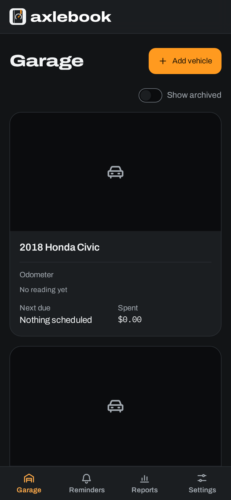
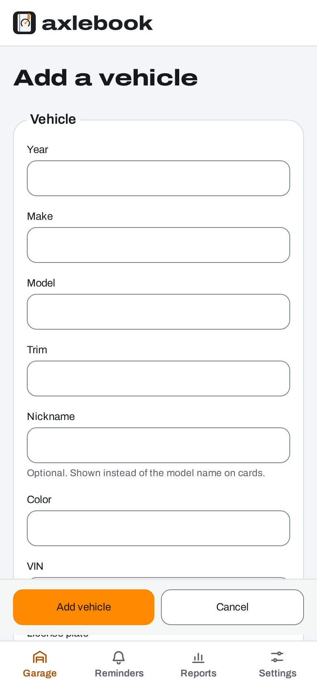

<picture>
  <source media="(prefers-color-scheme: dark)" srcset="logo-assets/social/readme-banner-dark-1600x400.png">
  
</picture>

<h3 align="center">Every mile, on the record.</h3>

<p align="center">
  A self-hosted, open-source maintenance logbook for your cars, trucks and bikes.<br>
  Service history, honest fuel economy, reminders that know your odometer, and every receipt in one place, on <b>your</b> server.
</p>

<p align="center">
  <a href="https://github.com/aubergine-ux/axlebook/actions/workflows/ci.yml"></a>
  <a href="LICENSE"></a>
  
  
  
</p>

<p align="center">
  <a href="#quick-start"><b>Quick start</b></a> ·
  <a href="#what-it-does">Features</a> ·
  <a href="#screenshots">Screenshots</a> ·
  <a href="#roadmap">Roadmap</a> ·
  <a href="CONTRIBUTING.md">Contributing</a>
</p>

<br>

<picture>
  <source media="(prefers-color-scheme: dark)" srcset="docs/screenshots/garage-dark.png">
  
</picture>

> [!NOTE]
> **Axlebook is in early development.** The foundation and the garage are built; records, fuel,
> reminders and the rest are landing one by one (see the [roadmap](#roadmap)). Star or watch
> the repo to follow along, but hold off on trusting it with your only copy of your records.

## Why Axlebook

<table>
  <tr>
    <td width="33%" valign="top">
      <br>
      <b>Your garage, your server</b><br>
      One <code>docker compose up</code>. SQLite by default, Postgres if you prefer. No accounts with us, no telemetry, no calls to anyone else's servers. Your logbook stays on your hardware.
    </td>
    <td width="33%" valign="top">
      <br>
      <b>Honest fuel economy</b><br>
      Full-to-full MPG (or L/100 km) that handles partial fills and the fill-up you forgot to log, instead of quietly averaging nonsense.
    </td>
    <td width="33%" valign="top">
      <br>
      <b>Reminders that know your odometer</b><br>
      Due by date, by distance, or whichever comes first. Log the oil change and the next one schedules itself. Email, ntfy, Gotify, Discord or a webhook.
    </td>
  </tr>
</table>

## What it does

|                                                                            | Feature                                                                                                                            |         |
| :------------------------------------------------------------------------: | ---------------------------------------------------------------------------------------------------------------------------------- | :-----: |
|   | **Garage.** A card per vehicle with photo, odometer, next reminder and cost to date. Archive the ones you've sold.                 |  Ready  |
|   | **Records.** Service, repairs, upgrades, taxes, registration and insurance, with tags, notes, and receipts or photos attached.     | Next up |
|  | **Odometer log.** Every record with a reading updates it, shown like the instrument cluster you read it from.                      | Next up |
|      | **Fuel.** Gallons or liters, price, full-tank flag. Logging at the pump takes seconds, even offline.                               | Planned |
|  | **Reminders.** Date, distance or both; recurring; upcoming, due soon and overdue at a glance.                                      | Planned |
|     | **Parts and supplies.** Inventory with cost, deducted automatically when you use them.                                             | Planned |
|   | **Planner.** Jobs you mean to do, turned into records when they're done.                                                           | Planned |
|   | **Reports.** Cost per month and category, cost per mile, MPG trends, lifetime totals. Printable.                                   | Planned |
|    | **Import and export.** CSV per record type, full backup and restore, and an importer for LubeLogger exports.                       | Planned |
|  | **Household-ready.** Admin, editor and viewer roles, per-vehicle sharing, optional single sign-on (Authentik, Authelia, Keycloak). | Planned |
|    | **REST API.** Everything the app can do, documented with OpenAPI at `/api/docs`.                                                   |  Ready  |

Also on the list: dark and light themes, imperial or metric, any currency, installable on your phone as an app, full keyboard access, and every string ready for translation.

## Screenshots

<table>
  <tr>
    <td width="68%" valign="top">
      <picture>
        <source media="(prefers-color-scheme: dark)" srcset="docs/screenshots/vehicle-dark.png">
        
      </picture>
    </td>
    <td width="16%" valign="top"></td>
    <td width="16%" valign="top"></td>
  </tr>
</table>

## Quick start

You need Docker with Compose v2.

```bash
git clone https://github.com/aubergine-ux/axlebook.git
cd axlebook
docker compose up -d
```

Open **http://localhost:8080** and add your first vehicle. Everything lives in the `axlebook-data` volume.

<details>
<summary><b>Run the published image instead of building</b></summary>

<br>

Release images for `linux/amd64` and `linux/arm64` are published to GitHub Container Registry with every tagged release.

```yaml
services:
  axlebook:
    image: ghcr.io/aubergine-ux/axlebook:latest # or pin a version, e.g. :0.1
    restart: unless-stopped
    ports:
      - "8080:8080"
    environment:
      BASE_URL: https://cars.example.com # your public URL
    volumes:
      - axlebook-data:/data
volumes:
  axlebook-data:
```
</details>

<details>
<summary><b>Use Postgres instead of SQLite</b></summary>

<br>

SQLite is the default and plenty for a household. For Postgres:

```bash
POSTGRES_PASSWORD=pick-something docker compose -f docker-compose.yml -f docker-compose.postgres.yml up -d
```

Or point `DATABASE_URL` at a server you already run. Migrations run automatically on startup either way.
</details>

<details>
<summary><b>Behind a reverse proxy</b></summary>

<br>

Set `BASE_URL` to the public URL and `TRUST_PROXY=true`. Axlebook rejects state-changing requests whose `Origin` doesn't match `BASE_URL` (CSRF protection), so it must be exactly what people type: scheme, host and port.
</details>

## Configuration

Everything is an environment variable and everything is optional. Put them in `.env` next to `docker-compose.yml`; [`.env.example`](.env.example) lists each one with a comment.

| Variable              | Default    | What it does                                                                        |
| --------------------- | ---------- | ----------------------------------------------------------------------------------- |
| `PORT`                | `8080`     | Port inside the container                                                           |
| `AXLEBOOK_PORT`       | `8080`     | Host port published by `docker-compose.yml`                                         |
| `BASE_URL`            |            | Public URL, e.g. `https://cars.example.com`. Pins the CSRF origin check             |
| `TRUST_PROXY`         | `false`    | Trust `X-Forwarded-*` headers from a reverse proxy                                  |
| `LOG_LEVEL`           | `info`     | `fatal` · `error` · `warn` · `info` · `debug` · `trace` · `silent`                  |
| `DATA_DIR`            | `/data`    | SQLite database, photos and attachments                                             |
| `DATABASE_URL`        |            | `postgres://…` to use Postgres; unset means SQLite in `DATA_DIR`                    |
| `MAX_UPLOAD_MB`       | `25`       | Largest single upload                                                               |
| `DEFAULT_UNIT_SYSTEM` | `imperial` | `imperial` or `metric` for new users                                                |
| `DEFAULT_CURRENCY`    | `USD`      | ISO 4217 code, used across the instance                                             |
| `DEFAULT_LOCALE`      | `en`       | Interface language for new users                                                    |
| `SEED_DEMO_DATA`      | `false`    | Seed a 2015 Tacoma and a 2018 Civic with history _(arrives with the first release)_ |

Settings for sign-in, email and notifications are added as those features land.

## Backups

All of Axlebook's state is in the data volume (with Postgres: the database plus the volume's photos and attachments).

```bash
# SQLite (default): stop, copy, start
docker compose stop axlebook
docker compose cp axlebook:/data ./axlebook-backup-$(date +%F)
docker compose start axlebook
```

Restore by stopping the container, running `docker compose cp ./axlebook-backup-YYYY-MM-DD/. axlebook:/data`, and starting it again.

```bash
# Postgres
docker compose exec db pg_dump -U axlebook axlebook > axlebook-$(date +%F).sql
docker compose cp axlebook:/data ./axlebook-files-$(date +%F)
```

A one-click backup and restore that moves between SQLite and Postgres is on the [roadmap](#roadmap).

## API

Everything is under `/api/v1`. Browse the interactive docs at **`/api/docs`** on your instance, or grab the spec from `/api/openapi.json`. Errors always look like `{ "error": { "code": "…", "params": { … } } }`.

## Roadmap

- [x] Foundation: API, SQLite and Postgres, automatic migrations, installable web app, Docker image, CI
- [x] Garage and vehicles, with photos
- [ ] Service, repair, upgrade and expense records with tags and attachments
- [ ] Odometer log, fuel fill-ups and fuel economy
- [ ] Reminders
- [ ] Parts inventory and planner
- [ ] Reports
- [ ] Import/export, backup and restore, LubeLogger import, search
- [ ] Accounts, roles, sharing, API tokens and single sign-on
- [ ] Notifications: email, ntfy, Gotify, Discord, webhooks
- [ ] Demo data and the first tagged release
- [ ] Offline fuel entry: log at the pump with no signal, sync later

## Built with

TypeScript end to end: [Fastify](https://fastify.dev) and [Kysely](https://kysely.dev) on the server, [React](https://react.dev), [TanStack Router](https://tanstack.com/router) and [React Aria](https://react-spectrum.adobe.com/react-aria/) in the browser, and [Tailwind CSS](https://tailwindcss.com) driven by the [Axlebook brand tokens](logo-assets/tokens.json). Type is set in Archivo and IBM Plex Mono, both self-hosted.

## Contributing

Bug reports, translations, docs and code are all welcome. [CONTRIBUTING.md](CONTRIBUTING.md) covers the dev setup (`npm ci && npm run dev`), the conventions and how to add a language. Please read the [code of conduct](CODE_OF_CONDUCT.md) too.

## License

[AGPL-3.0](LICENSE). Use it, change it and host it freely. If you run a modified version as a service for other people, share your changes under the same license.

<br>

<p align="center">
  <br>
  <sub>Axlebook · every mile, on the record</sub>
</p>
